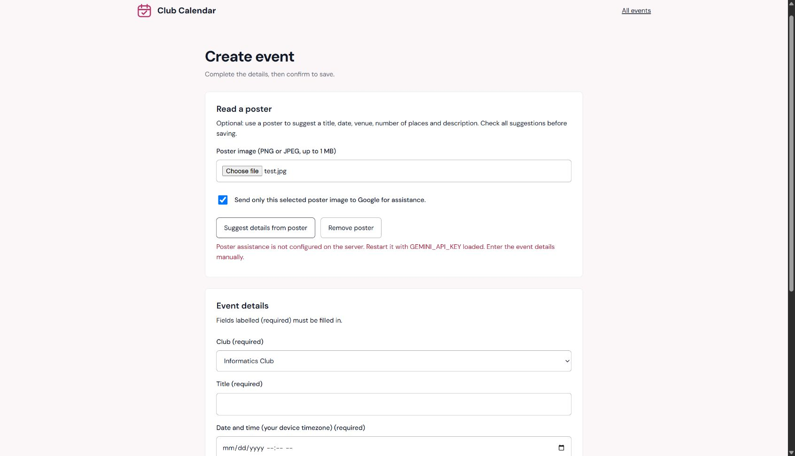

# UI checklist

<!-- Exercise 4 hands this in. Tick an item only when you have checked it, and replace
     the "how I checked" line with what you actually did. An unticked box is not a
     failure: it is a gap you then write into READINESS.md. A ticked box you cannot
     demonstrate at the defence is worse than an unticked one. -->

"Modern" is not a style. It is a short list of things a user notices when they are
missing: the screen tells you what is happening, you can get through it with a keyboard,
the text is readable, and nothing jumps around while it loads.

## Layout and typography

- [x] **One spacing scale and one type scale.** Sizes come from a small set of design tokens, not from numbers typed where they were needed.
  - how I checked: Inspected :root spacing/type tokens in src/web/styles.css; the same stylesheet serves all four screens.
- [x] **Responsive at 380, 768 and 1280 pixels wide.** No horizontal scrollbar, no text running under another element.
  - how I checked: Browser viewport captures at 380/768/1280 px for login, events, detail and editor: document scrollWidth equalled clientWidth. See screenshots below; manual responsive review was also reported complete.
- [x] **Nothing jumps while the page loads.** Images and cards reserve their space before their content arrives.
  - how I checked: Chrome DevTools measured zero CLS in the sampled sign-in, calendar, detail and create-editor initial loads. The final calendar and create-editor runs used Slow 4G with cache disabled. See the performance evidence below.

## The four states, on every screen

A screen that only handles "it worked" is a screen that lies to the user on the day it matters.

- [x] **Loading.** Something tells the user the app is working, within about 100 ms.
  - how I checked: Chrome DevTools reported 24 ms interaction-to-next-paint for sampled sign-in, refresh, registration and editor save actions. Calendar, detail and editor show a loading message in their initial HTML. Poster progress was observed while the request was pending. The poster action was captured with Chrome reporting a maximum interaction-to-next-paint of 32 ms across the recorded interactions, with Slow 4G and cache disabled. See ui/poster-performance-verified.png.
- [x] **Empty.** The screen says what this list is for and what to do next, instead of showing nothing.
  - how I checked: Captured the actual empty events response after temporarily moving fixture dates into the past, then restored exact dates. Detail has an empty-attendee notice; editor has a no-club notice; login has no data collection to empty (source review).
- [x] **Error.** A sentence a person can read. Never a raw JSON body, never a stack trace, never just "Error".
  - how I checked: Captured events error with Retry, invalid-password error and missing-model-key fallback. Browser-script/API tests verify detail/editor failures and readable save refusals.
- [x] **Success.** The user can see that what they did took effect, without reloading the page to find out.
  - how I checked: Populated events/detail/editor screenshots show returned data. Registration, cancellation and save workflows have browser-script/API tests; local functional review was reported complete.

## Keyboard and accessibility

- [x] **The main flow works with the keyboard alone.** Sign in, do the core action, sign out, without touching the mouse.
  - how I checked: Local keyboard-only main-flow review was reported complete before evidence collection; automated browser-script tests independently cover action behavior. This does not claim a live-site keyboard check.
- [x] **The focused element is visible.** A `:focus-visible` outline that is not switched off.
  - how I checked: Local keyboard review was reported complete; stylesheet inspection confirms a 3 px :focus-visible outline with 4 px offset, with no rule removing it.
- [x] **Text contrast is at least 4.5:1.** Name the tool you measured with.
  - how I checked: Measured browser-computed RGB combinations using the WCAG relative-luminance formula: events minimum 5.29:1, editor 5.44:1, login error 7.64:1 and primary button 16.55:1. Shared palette also serves details; disabled controls are excluded from the text minimum.
- [x] **Every input has a label** a screen reader reads, not just placeholder text.
  - how I checked: DOM audit found zero unlabelled visible inputs/selects/textareas on login and editor; every control has an associated label. Other screens have no form inputs.
- [x] **The page has a correct `<title>` and `lang`.**
  - how I checked: DOM audit confirmed lang=en on all screens. Browser and regression checks verified distinct Create event and Edit event titles. Login, calendar and event detail titles identify their screens.
- [x] **Touch targets are at least 44 pixels.**
  - how I checked: DOM bounding rectangles at all three widths found no visible interactive target below 44 px after fixing All events in the shared header. Checkbox target measured via its clickable consent label.

## The model feature

- [x] **It shows that it is thinking.** A model call is slow and a free service may have been asleep; a frozen button is the worst possible answer.
  - how I checked: Captured Reading the poster… with Suggest details disabled while a temporary disposable-database lock delayed authentication. This demonstrates pending UI, not a real provider latency measurement.
- [x] **It shows when it failed,** and the rest of the screen still works.
  - how I checked: Captured the actual missing-GEMINI_API_KEY response; form fields and save action remain available. No provider request was made.
- [x] **The user can tell the model's suggestion from a fact.** It is labelled as a suggestion, not presented as data the app knows.
  - how I checked: Editor explains suggestions must be checked and are not saved until confirmation; AC-7/AC-20 browser tests verify filling without save and ignoring stale suggestions.

## Decisions

- [x] **Dark mode, or a written decision not to have one.**
  - what I decided and why: retain the specified light palette so contrast/focus can be checked consistently; a second theme is outside the current scope.

## Evidence

<!-- Screenshots of at least the four states of one screen, and of the model feature
     thinking and failing. A link to them is enough; they do not have to be in the repo. -->

### Local browser capture — 2026-11-21

Collected on the disposable PostgreSQL preview at `http://localhost:3104`, not a deployed site.

- Events: [loading](ui/events-loading.jpg), [empty](ui/events-empty.jpg), [error with retry](ui/events-error.jpg), [populated](ui/events-success-1280.jpg).
- Events at [380 px](ui/events-success-380.jpg), [768 px](ui/events-success-768.jpg) and [1280 px](ui/events-success-1280.jpg).
- Create-event editor at [380 px](ui/editor-380.jpg), [768 px](ui/editor-768.jpg) and [1280 px](ui/editor-1280.jpg).
- Neither tested screen overflowed horizontally at those widths. Editor scroll/client widths were 365/365, 753/753 and 1265/1265 px; the vertical scrollbar accounts for the difference from viewport width.
- Loading/error were captured while a temporary lock delayed the disposable events query. Empty was captured with temporary past dates. All original dates were restored and the lock released; no application code was changed for these captures.

Contrast was calculated from browser-computed foreground/background RGB values using the WCAG relative-luminance formula. Events text combinations ranged from **5.29:1 to 17.74:1**; editor text combinations ranged from **5.44:1 to 17.74:1**. These measurements cover the captured populated events/editor states, not every error, focus or model state.

The [Chrome Network capture](ui/events-waterfall.png), with cache disabled and no throttling, recorded **8 requests, 56.1 kB transferred, DOMContentLoaded 553 ms, load 871 ms and finish 888 ms**. The external Google Fonts stylesheet took 479 ms and its font 319 ms; the events API request took 7 ms. These are one local measurement, not production performance results. Cache settings were restored after capture.

Poster evidence: [thinking](ui/poster-thinking.jpg) and [missing-key fallback](ui/poster-failure.jpg). Progress used a temporary sessions-table lock with automatic rollback; the fallback capture was a separate request after release. No image was sent to Google.

Final layout captures: [login](ui/login-380.jpg), [events](ui/events-final-380.jpg), [detail](ui/detail-380.jpg), [editor](ui/editor-final-380.jpg), with matching 768/1280 px files in docs/ui/. [Invalid-password notice](ui/login-error.jpg). All four final screen audits had matching scroll/client widths and no undersized visible targets. The editor captures with editor-final names supersede the earlier editor snapshots for the header target fix.

Performance evidence: [sign-in](ui/login-performance.png), [calendar refresh](ui/events-stability-fixed.png), [calendar final initial load](ui/events-stability-final.png), [detail](ui/detail-performance.png), [detail initial load](ui/detail-stability-final.png), [editor save](ui/editor-performance.png), [create editor initial load](ui/editor-stability-final.png). The calendar improved from about 0.05 CLS to 0 in the final sample. An intermediate edit-editor run had a small 0.0024 shift before reserving scrollbar space. Interaction time is measured from input to the next paint, independent of time to download the page.

Deployed-site evidence remains pending.
